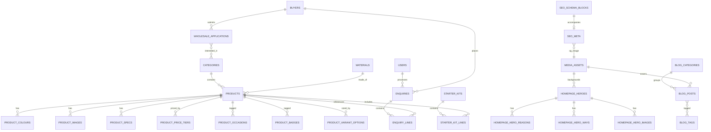

# Mehrusa Wholesale — Backend Architecture & Database Schema

**Project:** Mehrusa Wholesale Platform  
**Stack:** Laravel (PHP) + MySQL / MariaDB  
**Frontend (existing):** React + Vite (catalogue, enquiry list, wholesale apply)  
**Document purpose:** Architecture design and relational schema for backend implementation  
**Status:** Design / Schema deliverable (pre-implementation)

---

## 1. Business overview

Mehrusa is a Pakistani modest-fashion and stainless-steel jewellery brand selling **wholesale** to:

- Boutiques and modest-wear shops  
- Online / Instagram stores  
- Gifting companies and event planners  
- Market and exhibition sellers  

Buyers browse a catalogue, build an **enquiry list** (not a cart with payment), and send it via WhatsApp or email. New buyers also **apply for wholesale** access. The current frontend stores catalogue data in static files and never persists orders or applications on a server. The backend described here replaces that with a proper API + database.

---

## 2. Goals of the backend

| Goal | Description |
|------|-------------|
| Catalogue API | Serve categories, products, materials, pricing tiers from SQL |
| Wholesale applications | Persist and manage “Apply for wholesale” submissions |
| Enquiry / order intake | Store enquiry lists with buyer details and line items |
| Admin control | Staff can confirm prices, stock, terms, approve buyers |
| Homepage CMS | Admin can change home hero text, CTAs, reasons and images |
| Blogs / Journal | Full blog data (posts, categories, tags) managed from admin |
| SEO | Site defaults, per-page meta, Open Graph, schema.org JSON-LD, redirects |
| Pricing rules | Enforce MOQ and quantity-based wholesale tiers server-side |
| Media | Shared media library for products, hero, blogs and OG images |
| Auditability | Track enquiry status, application status, price changes |

**Out of scope for v1 (optional later):** online payment gateway, inventory warehouse system, full ERP, multi-vendor marketplace.

---

## 3. High-level architecture

```
┌─────────────────────────────────────────────────────────────┐
│                     Clients                                 │
│  React Storefront (existing)     Admin Panel (Laravel / SPA)│
└───────────────┬─────────────────────────────┬───────────────┘
                │ HTTPS JSON API              │ HTTPS (auth)
                ▼                             ▼
┌─────────────────────────────────────────────────────────────┐
│                   Laravel Application                       │
│  ┌──────────┐ ┌──────────┐ ┌──────────┐ ┌────────────────┐ │
│  │ API      │ │ Auth     │ │ Domain   │ │ Admin / Filament│ │
│  │ Controllers│ │ Sanctum │ │ Services │ │ or Blade CRUD  │ │
│  └────┬─────┘ └────┬─────┘ └────┬─────┘ └────────┬───────┘ │
│       │            │            │                 │         │
│  ┌────▼────────────▼────────────▼─────────────────▼───────┐ │
│  │              Eloquent Models + Repositories            │ │
│  └────────────────────────────┬───────────────────────────┘ │
│                               │                             │
│  ┌────────────────────────────▼───────────────────────────┐ │
│  │         MySQL  (schema in schema.sql)                  │ │
│  └────────────────────────────────────────────────────────┘ │
│  ┌──────────────┐  ┌──────────────┐  ┌───────────────────┐  │
│  │ File storage │  │ Queue / Jobs │  │ Mail / Notifications│ │
│  │ (images)     │  │ (emails, WA) │  │                    │  │
│  └──────────────┘  └──────────────┘  └───────────────────┘  │
└─────────────────────────────────────────────────────────────┘
```

### 3.1 Architectural style

- **Layered / modular monolith** in Laravel (recommended for internship scope).  
- Clear modules (Catalogue, Buyers, Applications, Enquiries, Settings, Auth).  
- REST JSON API for the React storefront.  
- Optional admin UI via Laravel Filament or Blade for staff.

### 3.2 Why this shape

- Matches current frontend needs without over-engineering microservices.  
- One deployable Laravel app + one MySQL database.  
- Easy to grow: later split “notifications” or “media” if needed.

---

## 4. System modules

### 4.1 Auth & users

| Role | Access |
|------|--------|
| `admin` | Full control: products, prices, applications, enquiries, homepage, blogs, SEO, settings |
| `staff` | Process applications and enquiries; limited catalogue / blog edits |
| `buyer` (optional v1.1) | Login to see past enquiries / approved status |

**Auth mechanism:** Laravel Sanctum (API tokens) for SPA / mobile; session for admin panel.

### 4.2 Catalogue

- Families: `jewellery`, `clothing`  
- Categories (rings, earrings, necklaces, pendants, bracelets, sets, abayas, unstitched)  
- Materials + verified/unverified facts  
- Products with SKU, colours, images, specs, badges, occasions  
- Wholesale unit (`piece` / `dozen` / `set` / `suit`), MOQ, stock mode, lead time  
- Price tiers by minimum quantity  

### 4.3 Buyers & applications

- Wholesale application form fields (name, business, city, country, phone, Instagram, sells, interests, order size, source, notes)  
- Buyer type (`boutique`, `online`, `gifting`, `market`)  
- Application status: `pending` → `approved` / `rejected` / `needs_info`  

### 4.4 Enquiries (order intake)

Current UX: “enquiry, not a payment.” Backend stores:

- Buyer snapshot (name, business, city, phone, notes)  
- Line items: product + colour + size/option + qty  
- Computed subtotal (when prices confirmed)  
- Channel: `whatsapp` / `email` / `api`  
- Status: `received` → `quoted` → `confirmed` → `cancelled` / `fulfilled`  

### 4.5 Starter kits

Curated opening assortments per buyer type (already in frontend as static data). Backend can serve and manage them.

### 4.6 Site settings / terms

MOQ rules, payment terms, shipping, WhatsApp number, email, lead times, seasonal flags — stored as key/value or a settings table so admin can update without redeploying frontend.

### 4.7 Media library

Central `media_assets` table (disk/S3). Used by product images, homepage hero, blog covers, and SEO Open Graph images. Admin uploads once and reuses.

### 4.8 Homepage hero CMS (Admin-editable)

Home hero is **not hardcoded**. Admin panel can change:

- Eyebrow, headline lines, supporting text  
- Primary / secondary CTA labels and URLs  
- Background image, side/facet images  
- Reason bullets (“Mix colours…”, “Order on WhatsApp…”)  
- “Ways to start” bar items  

Tables: `homepage_heroes`, `homepage_hero_reasons`, `homepage_hero_ways`, `homepage_hero_images`. Only one hero row is `is_active = 1` at a time. Public API: `GET /api/v1/homepage/hero`.

### 4.9 Blogs / Journal

Replaces the empty Journal placeholder with real content:

- `blog_categories`, `blog_tags`, `blog_posts`, `blog_post_tag`  
- Draft / scheduled / published / archived workflow  
- Cover image, excerpt, author, featured flag  
- Each post can have its own SEO meta + Article schema  

Public API: `GET /api/v1/blogs`, `GET /api/v1/blogs/{slug}`.

### 4.10 SEO module

| Piece | Table / mechanism | Admin can edit |
|-------|-------------------|----------------|
| Site-wide defaults | `seo_site_defaults` | Title template, description, OG image, GA/GTM, robots.txt |
| Per-page / per-entity meta | `seo_meta` | Title, description, keywords, canonical, robots, OG, Twitter |
| Structured data | `seo_schema_blocks` | Organization, WebSite, Product, Article, FAQPage, BreadcrumbList JSON-LD |
| Redirects | `seo_redirects` | 301/302 old → new paths |
| Sitemap | Generated from published products, blogs, pages | Toggle via `sitemap_enabled` |

`seo_meta` is polymorphic (`seoable_type` + `seoable_id` / `route_key`) so Home, Shop, Product, Category, Blog and CMS pages all share one SEO pattern.

---

## 5. Request flow examples

### 5.1 Browse catalogue

```
GET /api/v1/categories
GET /api/v1/products?category=rings&badge=new&sort=newest
GET /api/v1/products/{slug}
```

### 5.2 Submit wholesale application

```
POST /api/v1/applications
→ validate → store applications + interest categories → notify admin
```

### 5.3 Submit enquiry list

```
POST /api/v1/enquiries
{
  "buyer": { "name", "business", "city", "phone", "notes" },
  "channel": "whatsapp",
  "lines": [
    { "product_id": 12, "colour": "Gold-coloured", "option": "7", "qty": 12 }
  ]
}
→ resolve prices by tier → store enquiry + lines → status = received
```

### 5.4 Admin confirms price / stock

```
PUT /api/admin/products/{id}/tiers
PUT /api/admin/products/{id}/stock
```

### 5.5 Homepage hero + blogs + SEO (public)

```
GET /api/v1/homepage/hero
GET /api/v1/blogs?category=materials&page=1
GET /api/v1/blogs/{slug}
GET /api/v1/seo?route=home
GET /api/v1/seo/schema?route=home
```

### 5.6 Admin CMS examples

```
PUT  /api/admin/homepage/heroes/{id}          # change hero text / CTAs
POST /api/admin/media                         # upload hero / blog / OG image
POST /api/admin/blogs                         # create journal post
PUT  /api/admin/seo/defaults                  # site SEO defaults
PUT  /api/admin/seo/meta/{type}/{id}          # per-page SEO
PUT  /api/admin/seo/schema/{id}               # JSON-LD block
```

---

## 6. Laravel folder / module map

```
app/
  Models/           # Eloquent models matching schema
  Http/
    Controllers/Api/V1/
    Controllers/Admin/
    Requests/       # Form Request validation
    Resources/      # API transformers (match frontend Product shape)
  Services/
    PricingService.php      # tier + MOQ logic (port of src/lib/pricing.ts)
    EnquiryService.php
    ApplicationService.php
  Enums/
    BuyerType, EnquiryStatus, ApplicationStatus, StockMode, Family, ...
  Jobs/
    NotifyAdminOfEnquiry.php
    NotifyAdminOfApplication.php
database/
  migrations/       # generated from schema.sql
  seeders/          # categories, materials, placeholder products
routes/
  api.php
  admin.php
```

---

## 7. Pricing & business rules (server-side)

Ported from the existing frontend (`pricing.ts` / `message.ts`):

1. **MOQ** — each product has `min_order_qty` (e.g. 12).  
2. **Tiers** — highest tier whose `min_qty <= total qty of that product` wins.  
3. **Cross-variant aggregation** — colour/size variants of the *same product* sum together for tier selection.  
4. **Null prices** — if `price_pkr` is null, show “price on request”; enquiry still allowed.  
5. **Enquiry ≠ payment** — no payment capture in v1.  
6. **Verified facts** — material facts with `verified = false` must not be exposed as confirmed claims in public API.

---

## 8. Security & quality

- Validate all public POSTs with Form Requests + rate limiting.  
- Sanctum / role middleware on admin routes.  
- Mass-assignment protection; hide internal cost fields from public Resources.  
- Soft deletes on products, buyers, enquiries where useful.  
- Indexes on `sku`, `slug`, foreign keys, status columns.  
- Store phone in normalized form (E.164 where possible).  
- CORS configured for the React origin.  
- `.env` for DB credentials; never commit secrets.

---

## 9. Entity-relationship overview



---

## 10. Suggested API surface (v1)

| Method | Endpoint | Auth | Purpose |
|--------|----------|------|---------|
| GET | `/api/v1/categories` | Public | List categories |
| GET | `/api/v1/products` | Public | Catalogue with filters |
| GET | `/api/v1/products/{slug}` | Public | Product detail |
| GET | `/api/v1/materials/{slug}` | Public | Material facts (verified only for public) |
| GET | `/api/v1/starter-kits` | Public | Buyer starter kits |
| GET | `/api/v1/settings/public` | Public | WhatsApp, email, MOQ copy, season |
| GET | `/api/v1/homepage/hero` | Public | Active home hero (text + images) |
| GET | `/api/v1/blogs` | Public | Journal / blog listing |
| GET | `/api/v1/blogs/{slug}` | Public | Blog post detail |
| GET | `/api/v1/seo` | Public | Meta for route / entity |
| GET | `/api/v1/seo/schema` | Public | JSON-LD blocks for page |
| POST | `/api/v1/applications` | Public | Wholesale apply |
| POST | `/api/v1/enquiries` | Public | Submit enquiry list |
| POST | `/api/v1/contact` | Public | Contact form |
| * | `/api/admin/*` | Admin | Catalogue, hero CMS, blogs, SEO, apps/enquiries |

---

## 11. Implementation phases (after this design)

| Phase | Work |
|-------|------|
| 1 | Create Laravel project, run migrations from `schema.sql`, seed categories/materials/products |
| 2 | Public catalogue + settings APIs; wire React to API |
| 3 | Applications + enquiries POST endpoints + admin review |
| 4 | Admin product/price/stock management |
| 5 | Homepage hero CMS + media library (admin editable) |
| 6 | Blogs / Journal CRUD + public blog API |
| 7 | SEO defaults, per-page meta, schema.org JSON-LD, redirects, sitemap |
| 8 | Notifications (email / optional WhatsApp Business API) |
| 9 | Buyer accounts (optional) |

---

## 12. Deliverables in this folder

| File | Contents |
|------|----------|
| `BACKEND_ARCHITECTURE.md` | This architecture document |
| `schema.sql` | Full MySQL schema (tables, keys, indexes, comments) |
| `SCHEMA_REFERENCE.md` | Table-by-table field reference for review/submission |

---

## 13. Notes for reviewers

- Schema mirrors the **existing React data model** (`types.ts`, `products.ts`, `buyers.ts`, Apply form, enquiry list store) so frontend migration is straightforward.  
- Design keeps current UX: **enquiry-first wholesale**, not e-commerce checkout.  
- Prices and many product facts may remain `NULL` / unverified until the owner confirms them — the schema supports that explicitly.
